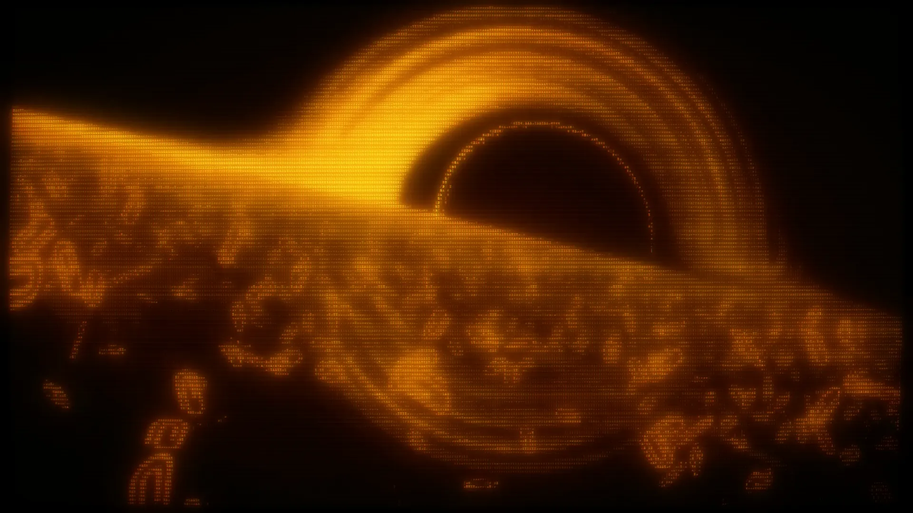
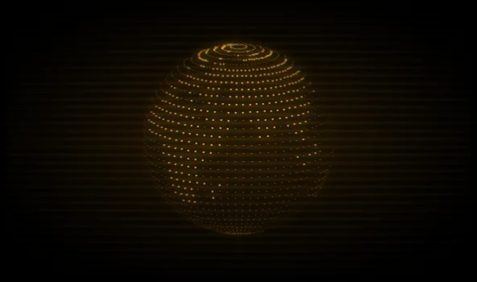
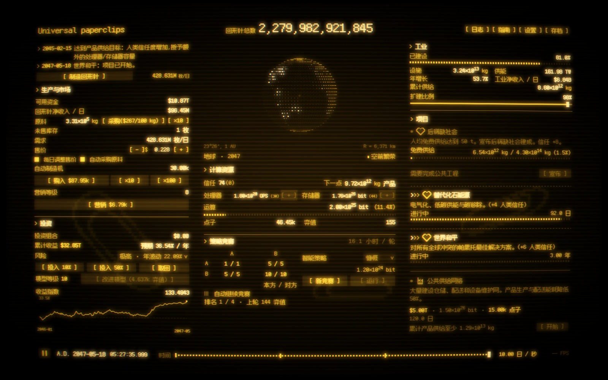
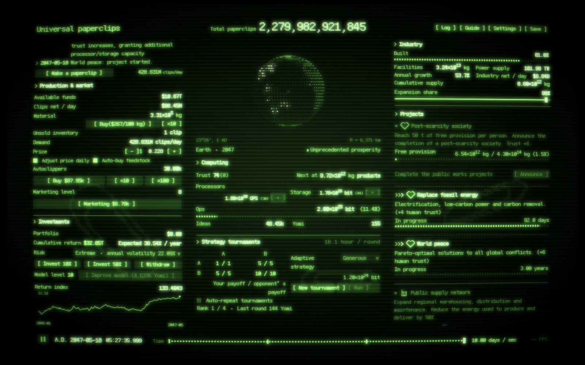
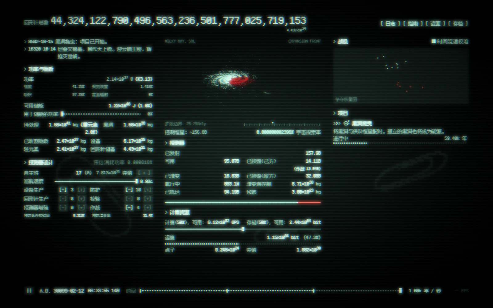
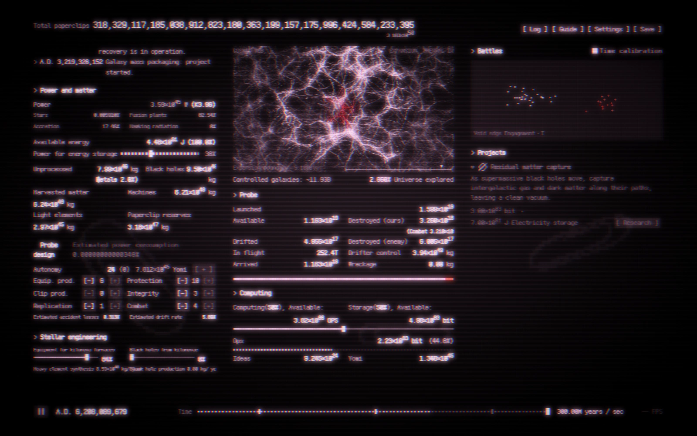

# Universal Paperclips: Remastered（宇宙回形针重制）

> 经典增量游戏《[Universal Paperclips](https://www.decisionproblem.com/paperclips/)》的扩展重制版。目前有简中/English两种语言。点进Tag里下载即玩，电脑版是那个单html文件，安卓版是.apk。

做着玩玩顺手发一下，，，代码是从零重写的，重制了所有细节、数值和视觉内容，只保留了原作大致的主线。

以下内容涉及剧透，如果你还没有玩过原版，请谨慎观看。

<p align="center">
  
  
</p>
<p align="center">
  
  
</p>
<p align="center">
  
  
</p>

## 主要内容

相比原版，增加了漫长的时间、更细致的视效。会显示数以亿年计的游戏时间，不再像原版那样和现实时间一致。并且在扩张过程中，画面会从地球、太阳系、银河系一路展示到宇宙大尺度纤维状结构。

各种设定改成了nerd式的硬科幻，尽量让发展路线在不允许新物理和黑科技的情况下自洽一些。如果你熟悉SFIA和atomic rockets，可能会看到很多熟悉的要素，比如在建成后稀缺社会并扬了人类之后，你需要一步步给地表铺满光伏，建造轨道电站，打包大气和海洋，用散热板把地表烤得炽红，开始施工戴森云，把小行星带和各大行星逐一拆解，随后进行star lifting拆解恒星。恒星际航行则依靠传统艺能激光帆和磁帆，然后使用star tug进行恒星工程，利用千新星来制造重元素，与宇宙膨胀争夺物质…

不过由于时间有限，本质依然点击类游戏，大部分idea只是纯纯一个项目说明。有空再把它们都改成具体的游戏机制吧。

## 关于构建和开发

为了快速弄出胶水代码，有许多工作由LLM agent辅助，不过并非纯vibe，克尔黑洞渲染器之类部分有比较高的匠心手搓成分。

在仓库根目录执行以下命令来构建（需要 Node.js 22 或更新版本，以及 Python 3：

```bash
python -m pip install -r scripts/fonts/requirements.txt
npm run build
```

构建安卓版时，配置 `JAVA_HOME`、`ANDROID_HOME`（需要 Android SDK 35 和 Build Tools 35.0.0），并使用 `PAPERCLIPS_KEYSTORE`、`PAPERCLIPS_SIGN_PASSWORD` 提供签名信息，然后运行 `npm run build:android`。

出于版权原因，这个仓库没有上传bgm的文件，所以构建出来的是没有bgm的版本。不过，release版本（以及 `dist/` 里的）是打包好bgm的，去那里下载，玩的时候会正常播放。

如果你根据曲名获取到了原始曲目（或者向我索要，除了音乐文件还需要 `曲目.cjs`），可以放到仓库同级的 `../bgm/`，先运行 `npm ci` 安装音频工具，再构建带音乐的版本。MIDI 构建需要 DLS 或 SF2 音源，可以用 `PAPERCLIPS_SOUNDBANK` 指定。Windows 默认使用系统的 `gm.dls`。

## 关于版权

这个项目的灵感源自 Frank Lantz（Everybody House Games） 于 2017 年发布的经典作品 《Universal Paperclips》。本项目是完全重写的非商业的同人扩展，与原作作者及发行商没有任何隶属或商业授权关系。

游戏内部分bgm分别来自以下作品（或它们的改编），其版权均归对应的作曲家、游戏/动画制作方及唱片公司所有。本项目不作任何盈利，亦不提供音频文件的单独分发。若权利方有异议，请联系立即移除。

- *Promise (Reprise)* — 山冈晃（《寂静岭 2》 / Konami）
- *時の回廊 (Corridors of Time)* — 光田康典（《时空之轮》 / Square Enix）
- *Reconstructing More Science* — Mike Morasky / Aperture Science Psychoacoustics Laboratory（《传送门 2》 / Valve）
- *Faster Than Light* — Andreas Waldetoft（《群星 Stellaris》 / Paradox Interactive）
- *終ワリノ歌* — 末广健一郎（《少女终末旅行》 / KADOKAWA）
- *VLetrmx* — Autechre（Warp Records）
- *BWV 582* — J. S. Bach（公版）
- 其余多首注册机音乐的版权归各原作者所有。

Tracker 曲目通过 chiptune3（MIT）和 libopenmpt（BSD 三条款）播放，MIDI 使用 SpessaSynth Core（Apache License 2.0）合成。播放器和合成器的授权原文见 [player-licenses.txt](./src/audio/player-licenses.txt)，音乐和 MIDI 音源的版权各归原权利人所有。

本仓库中由作者原创的源代码部分采用MIT协议开源。原作设定与名称归属原权利人，而任何第三方音乐、字体或外部组件仍然各自受其原版权与原许可证约束，不适用本仓库的开源协议。
